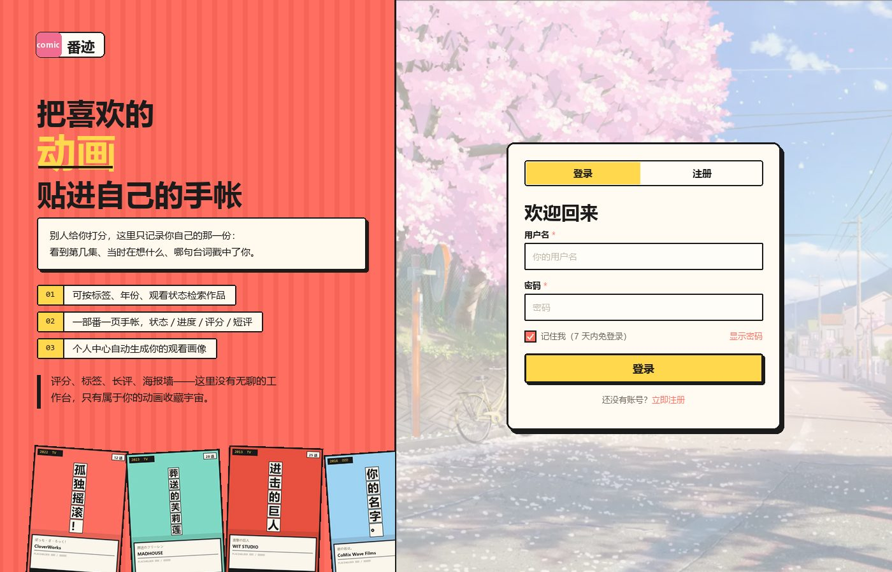
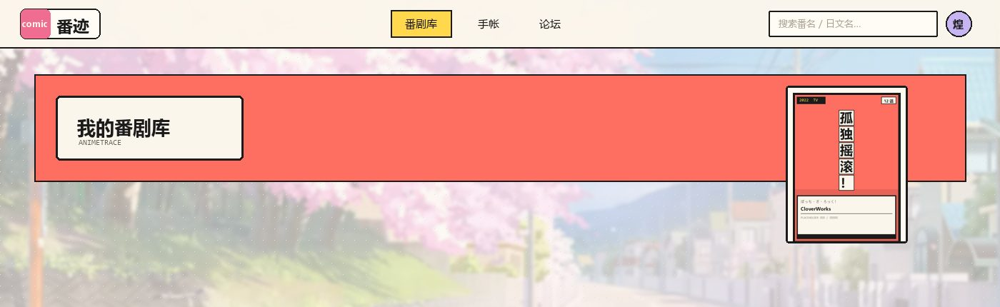

<div align="center">

# 番迹 AnimeTrace

**把喜欢的动画，贴进自己的手帐。**

纯前端 · 零后端 · 数据只存在你自己的浏览器里

`Vue 3.5` · `Vite 5` · `Vue Router 4` · `Pinia` · `原生 CSS + CSS 变量`

**[快速开始](#快速开始)** · **[功能地图](#功能地图)** · **[路由表](#路由表)** · **[目录结构](#目录结构)** · **[关键文件速查](#关键文件速查)** · **[数据层](#数据层)** · **[角色分工](#角色分工)** · **[文档索引](#文档索引)** · **[命令速查](#命令速查)** · **[部署](#部署github-pages)** · **[自检与验收](#自检与验收)** 



</div>

---

## 这是什么

一个「个人追番档案馆」：**番剧库检索 → 手帐记录 → 论坛交流 → 个人中心画像**。

- 不接后端、不做真实鉴权，所有数据（账号、手帐、帖子、评论）存在浏览器 `localStorage` 的单个键里；
- 刷新不丢，换浏览器/清缓存就是新账号；个人中心有一键「重置演示数据」回到初始种子；
- 5 人小组的课程作业，代码按「一人一间屋」切成 5 块目录，谁改哪块写在 [角色分工](#角色分工) 里。

演示账号：**demo / demo1234**（种子里另有 3 个账号，密码同为 `demo1234`，见 `src/data/seed.js` 的 `DEMO_ACCOUNTS`）。



## 快速开始

```bash
# 需要 Node >= 18
npm install
npm run dev        # http://localhost:5173
```

打开后用 `demo / demo1234` 登录；想从头看一遍种子数据，去「个人中心 → 重置演示数据」。

> 如果 `npm install` 卡在 postinstall（esbuild 之类的子进程被拦截），加参数再装一次：
> `npm install --cache ./.npm-cache --ignore-scripts`。

## 功能地图

| 模块 | 页面 | 负责人 | 内容 |
| --- | --- | --- | --- |
| 账号 | [/login](src/views/auth/LoginView.vue) · [/register](src/views/auth/RegisterView.vue) | A | 登录、注册、`?redirect=` 回跳、刷新保持登录、全局路由守卫 |
| 番剧库 | [/library](src/views/anime/AnimeLibraryView.vue) | B | 搜索（标题/日文名/制作公司）· 标签/年份/状态组合筛选 · 三种排序 · 分页 · 双视图 · 详情弹窗 |
| 手帐 | [/journal](src/views/journal/JournalView.vue) · [/journal/new](src/views/journal/JournalEditView.vue) · [/journal/:id](src/views/journal/JournalDetailView.vue) | C | 手帐墙 · 新建/编辑表单 · 详情 |
| 论坛 | [/forum](src/views/forum/ForumListView.vue) · [/forum/new](src/views/forum/PostCreateView.vue) · [/forum/:id](src/views/forum/PostDetailView.vue) | D | 板块筛选 · 发帖 · 详情 · 评论 · 点赞 |
| 个人中心 | [/profile](src/views/profile/ProfileView.vue) | E | 资料卡 · 状态环图 · 评分柱图 · 标签条形图 · 月度热力图 · 重置数据 |

## 路由表

Hash 模式（`createWebHashHistory`），静态托管不需要 404 回退。

| 路径 | 名称 | 守卫 | 说明 |
| --- | --- | --- | --- |
| `/login` | login | guestOnly | 已登录访问会跳走 |
| `/register` | register | guestOnly | 同上 |
| `/library` | library | 公开 | 首页 |
| `/journal` | journal | 需登录 | 手帐墙 |
| `/journal/new` | journal-new | 需登录 | `meta.mode = 'create'` |
| `/journal/:id` | journal-detail | 需登录 | |
| `/journal/:id/edit` | journal-edit | 需登录 | `meta.mode = 'edit'` |
| `/forum` | forum | 需登录 | |
| `/forum/new` | forum-new | 需登录 | |
| `/forum/:id` | forum-detail | 需登录 | |
| `/profile` | profile | 需登录 | |

未匹配路径重定向 `/library`；番剧详情是弹窗，不占路由。路由模块按 `src/router/modules/*.js` 分文件，由 `import.meta.glob` 聚合。

## 目录结构

```
.
├─ index.html
├─ package.json
├─ vite.config.js              # base: './'，GitHub Pages / file 预览都不丢资源
├─ eslint.config.js            # flat config，要求 0 error
├─ public/
│  ├─ bg/sakura.jpg            # 全站背景照片（1280px 宽，薄纱浓度看 --veil）
│  └─ covers/a001–a010.jpg     # 占位海报（600×840，脚本生成）
├─ docs/                       # 四份协作文档 + screenshots/
├─ scripts/
│  ├─ gen_covers.py            # 占位海报生成脚本（Pillow）
│  └─ verify.mjs               # 无浏览器自检：SFC 编译 + 数据层冒烟
└─ src/
   ├─ main.js  App.vue
   ├─ router/                  # index.js + modules/{auth,anime,journal,forum,profile}.js
   ├─ styles/                  # tokens.css  base.css  utilities.css
   ├─ types/db.js              # 常量、枚举、实体字段说明（无业务数据）
   ├─ data/                    # db.js（唯一数据出入口）+ seed.js（种子常量）
   ├─ stores/session.js        # Pinia，只存登录态
   ├─ composables/             # useForm  useToast  usePagination  useStats
   ├─ utils/                   # format.js  hash.js
   ├─ components/
   │  ├─ ui/                   # 12 个基础件
   │  └─ layout/               # AppHeader  AppFooter  AppLogo  MobileTabBar  AuthShell  PageStub
   └─ views/                   # auth / anime / journal / forum / profile
```

## 关键文件速查

| 想看什么 | 去哪 |
| --- | --- |
| 所有数据读写函数（25 个） | [src/data/db.js](src/data/db.js) · 契约详见 [docs/01-接口契约.md](docs/01-接口契约.md) |
| 10 部番剧 / 10 条手帐 / 8 帖 / 3 用户 的种子数据 | [src/data/seed.js](src/data/seed.js) |
| 状态枚举、板块、实体字段 | [src/types/db.js](src/types/db.js) |
| 颜色 / 字号 / 间距 / 阴影 token | [src/styles/tokens.css](src/styles/tokens.css) |
| 背景照片 + 薄纱（`--veil`） | [src/styles/base.css](src/styles/base.css) · [src/App.vue](src/App.vue) |
| 12 个基础组件 | [src/components/ui/](src/components/ui) |
| 导航 / 尾页 / 移动端 TabBar / 登录分栏 | [src/components/layout/](src/components/layout) |
| 路由与全局守卫 | [src/router/index.js](src/router/index.js) |
| 登录态 | [src/stores/session.js](src/stores/session.js) |
| 表单、Toast、分页、统计 | [src/composables/](src/composables) |

## 技术栈与硬性约束

| 层 | 选型 | 说明 |
| --- | --- | --- |
| 框架 | Vue 3.5（`<script setup>`） | 全量组合式 API，不写 Options |
| 构建 | Vite 5 | 开发服务器 + 构建，`base: './'` |
| 路由 | Vue Router 4（hash） | 静态托管免配置 |
| 状态 | Pinia | **只存登录态**，业务数据一律走 db.js |
| 样式 | 原生 CSS + CSS 变量 | 无 UI 库、无 Tailwind，组件内 `scoped` |
| 图表 | 手写 SVG / CSS | 无图表库，环图、柱图、条形图、热力图都是自己画的 |

验收会查的硬约束：**不引 UI 库、不引图表库、业务数据不绕过 db.js、ESLint 0 error、产物 gzip < 500KB、单张海报 < 120KB**。

## 数据层

- 存储：单键 `fanji.db.v1`，值形如 `{ version, users, session, journal, posts, comments }`。
- 番剧目录**不进存储**，来自 `src/data/seed.js` 常量，改目录只改 seed。
- 所有读写都过 `src/data/db.js`，页面不准直接碰 `localStorage`。
- 返回的都是副本，页面改了不污染库；写操作会让 `dbTick` 自增。
- 需要实时刷新的页面这样订阅：`computed(() => (db.dbTick.value, db.listJournal(uid)))`。
- `resetAll()` 清库重灌种子；`dump()` 导出整库快照（调试用）。
- 接口冻结日 **11-27**，之后改契约走 RFC，见 [docs/03-协作制度.md](docs/03-协作制度.md)。

## 角色分工

| 角色 | 负责 | 可改目录 |
| --- | --- | --- |
| **A 组长 · 架构** | 工程地基、数据层、公共件、登录注册、集成与部署 | `package.json` `vite.config.js` `router` `styles` `types` `data` `stores` `composables` `utils` `components/ui` `components/layout` `App.vue` `main.js` |
| **B · 番剧库** | 检索筛选排序分页、双视图、详情弹窗 | `views/anime` |
| **C · 手帐** | 手帐墙、编辑表单、详情 | `views/journal` |
| **D · 论坛** | 列表、发帖、详情、评论点赞 | `views/forum` |
| **E · 个人中心** | 资料卡、四图可视化、重置数据 | `views/profile` |

一句话规则：**一人一间屋**——B/C/D/E 只改自己 `views` 下的文件，公共件有需求找 A，不改别人的屋。

## 文档索引

| 文档 | 内容 |
| --- | --- |
| [01 接口契约](docs/01-接口契约.md) | `db.js` 全部函数签名、实体字段、校验规则、错误约定 |
| [02 设计系统](docs/02-设计系统.md) | 颜色/字号/间距/阴影 token、12 个基础件 props、composable 用法、背景与薄纱 |
| [03 协作制度](docs/03-协作制度.md) | 房间制、分支与合并节奏、周会与评审、RFC 流程、日志模板 |
| [04 验收清单](docs/04-验收清单.md) | 逐项验收表、答辩准备、提交材料清单 |

## 命令速查

| 命令 | 作用 |
| --- | --- |
| `npm run dev` | 本地开发，端口 5173 |
| `npm run build` | 构建到 `dist/` |
| `npm run preview` | 预览构建产物 |
| `npm run lint` | ESLint（要求 0 error） |
| `npm run lint:fix` | 自动修可修的 |
| `npm run verify` | 不用浏览器自检：编译全部 `.vue` + 数据层 22 项断言 |
| `npm run format` | Prettier 格式化 `src/` |

## 自检与验收

```bash
npm run lint
npm run verify
```

`scripts/verify.mjs` 用 `@vue/compiler-sfc` 把全部 `.vue` 编译一遍（语法/模板错误在这里就炸），再在内存 localStorage 桩上跑一遍数据层：注册、登录、手帐增删改、发帖、评论、点赞、收藏、重置、工具函数。**两个命令都绿了再提交**。

逐项验收表见 [docs/04-验收清单.md](docs/04-验收清单.md)。

## 部署（GitHub Pages）

`vite.config.js` 已设 `base: './'`，路由用 hash，静态托管不需要额外配置。

**方式一：GitHub Actions（推荐）**

仓库 Settings → Pages → Source 选 **GitHub Actions**，然后推送即自动构建部署；工作流在 [`.github/workflows/deploy.yml`](.github/workflows/deploy.yml)，成功后地址是 `https://<用户名>.github.io/<仓库名>/`。

**方式二：手动推 gh-pages**

```bash
npm run build
npx gh-pages -d dist        # 或把 dist/ 手动推到 gh-pages 分支
```

再到 Settings → Pages 选 `gh-pages` 分支根目录。打开线上站点后，先去个人中心点一次「重置演示数据」，确保演示账号存在。


## 分支与提交约定

- `main` 永远可运行；功能在自己分支上做，合并前必须 `npm run lint && npm run verify` 全绿。
- 提交信息：`feat(模块): 做了什么` / `fix(模块): 修了什么` / `docs: ...` / `chore: ...`。
- 每人一个分支：`feat/anime`、`feat/journal`、`feat/forum`、`feat/profile`；合并冲突只在 `router/modules` 里出现，改完记得本地跑一遍。
- 不提交 `node_modules`、`dist`、`.npm-cache`（见 [.gitignore](.gitignore)）。


## 已知限制

- 账号体系是**本地模拟**，密码只做不可逆摘要存在本地，不构成真实鉴权，登录页已写明。
- 数据只在本浏览器，换设备/清缓存即重置；不做多端同步。
- 番剧目录是 10 部固定种子，不支持用户新增番剧。
- 移动端只做了 TabBar 与响应式布局，未做 PWA / 离线缓存。

## 许可

课程作业用途。代码可自由参考；占位海报由 `scripts/gen_covers.py` 生成，不含第三方素材。
